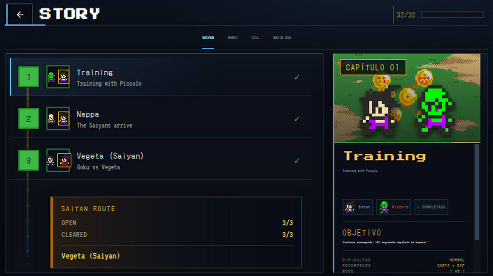
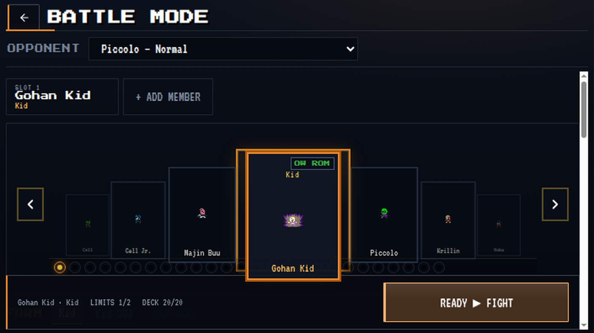
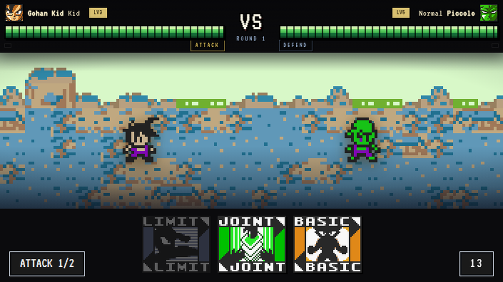
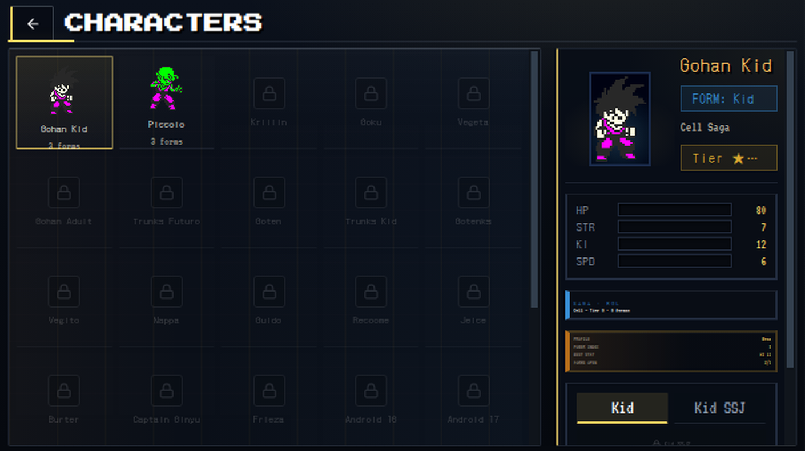
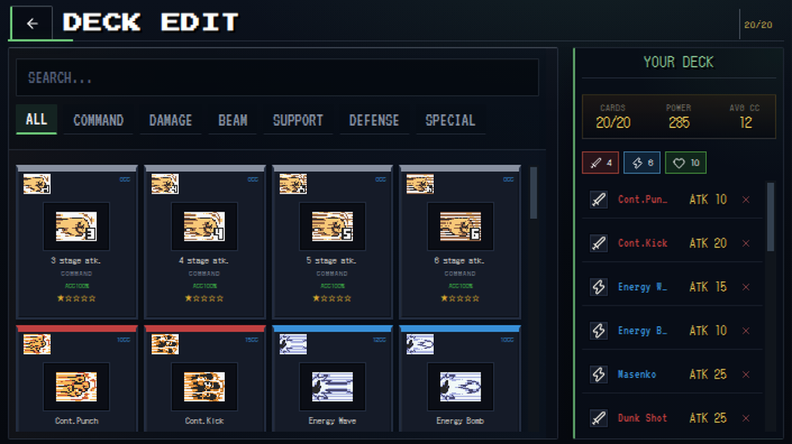
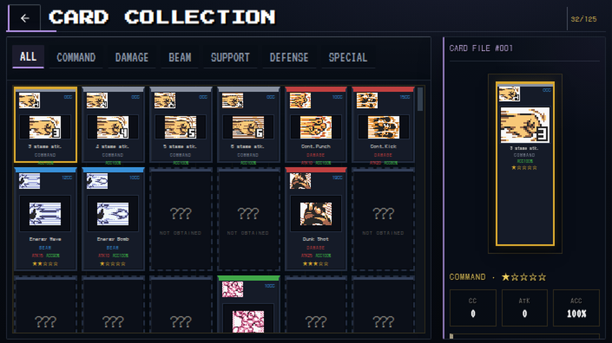
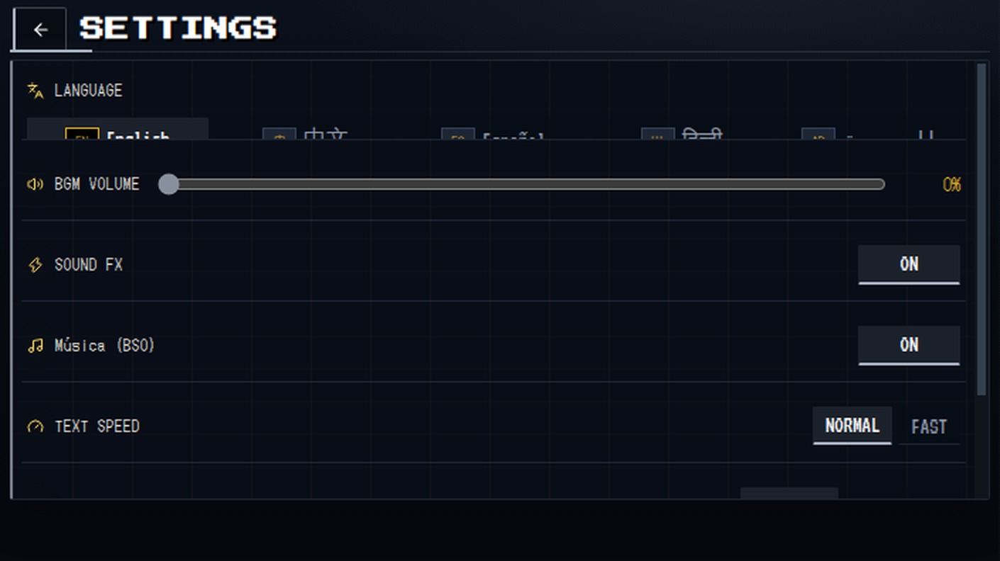

<div align="center">

# 🐉 DBZ LSW Fangame

**A byte-faithful web remake of *Dragon Ball Z: Legendary Super Warriors* (Game Boy Color, 2002)**

[](https://github.com/smouj/dbz-lsw-fangame/actions/workflows/verify.yml)


Card-based turn combat · 4 tactical positions · Stage Attack QTEs · 48 playable forms · ROM-exact sprites

</div>

---

## 📸 Screenshots

| Main Menu | Story Map | Battle Setup |
|:---:|:---:|:---:|
|  |  |  |

| Battle | Characters | Deck Builder |
|:---:|:---:|:---:|
|  |  |  |

| Card Collection | Settings |
|:---:|:---:|
|  |  |

---

## ✨ What is this?

**DBZ LSW Fangame** is a high-fidelity remake of the GBC classic: turn-based card combat with 4 tactical positions (AIR/GROUND × FRONT/BACK), a full CC (Combo Count) economy, Stage Attack QTEs with canonical deterministic sequences, beams, Gather Power, and 48 playable forms — all rendered with **authentic sprites extracted from the ROM** and the original's combat rhythm.

The **ROM and its local decompilation** (`dbz-lsw-decomp/`) are the source of truth. Nothing is re-imagined as a new game: mechanics, timings, sequences and identities are verified against the original binary.

- **663+ commits** · **92 automated verification suites** (`npm run verify:*`) · ROM-verified pipeline
- Canonical ROM: España `CRC32 9DAD6E23` · Reference decomp: USA `025AA88A`
- Combat clock: **59.7275 fps GBC** (deterministic accumulator, events on exact tick)

---

## 🚀 Getting Started

```bash
npm install
npm run dev          # dev server → http://localhost:5178
npm run build        # production build
npm run typecheck    # TypeScript (tsc --noEmit)
```

> GitHub Actions runs typecheck + build + a subset of suites on every push to `main` (`.github/workflows/verify.yml`).

### ✅ Verification suites

The project exposes **92 verifiers** (`npm run verify:*`). Main groups:

```bash
npm run verify:profiles               # signature profiles: every combat card has its own animation
npm run audit:sprites                 # 48 forms / manifests / beam-ray: integrity + physical dimensions
npm run verify:gbc                    # GBC invariants: positions, deck, canonical sequences, coverage
npm run verify:rom-fighter-identity   # form identity 48/48
npm run verify:rom-physical-corpus    # physical corpus 505 IDs / 2374 frame instances
npm run verify:rom-fx-film-contract   # offensive FX 28/28 STATIC_COMPLETE
npm run verify:rom-physical-key-bridge # profile-specific structured bridge (16 ✓)
npm run verify:character-frame-map    # honest F-MAP (22 ✓)
```

See `docs/` for specifications. Run `npm run` and filter by `verify:` for the full list.

---

## 🎮 Canonical Gameplay (GBC)

| System | Implementation |
|---|---|
| **Turn** | TURN → 2 EXCHANGES (inverted roles), order by effective SPD |
| **Positions** | 4 tactical: AIR/GROUND × FRONT/BACK; Beam vulnerable vs AIR, Damage vs GROUND |
| **CC (Combo Count)** | +3 on attack · +1 per QTE input · +1/+2 when hit · +1 for position vulnerability · basics free |
| **Defense** | Defender chooses BEFORE resolution: BASIC (Defense/Move 2 axes + push) / JOINT / LIMIT |
| **Stage Attack** | QTE with **canonical deterministic sequences** (fixed pool, round-robin rotation): 3S=6 A/B variants, 4/5/6S add directions |
| **Enemy AI** | GBC rhythm: regular attack ×2 → Gather Power → 5 Stage → Beam/Damage → repeat |
| **Gather Power** | +4 STR/KI, unlocks Limit Deck, turns Basic 3 Stage → 4 Stage |

**Orchestration**: single timeline clocked at **59.7275 fps GBC** (deterministic accumulator, events emitted on exact tick). Card cinematic: `FIELD → ACTION_SOLO → PROJECTILE/ACTION_DUEL → IMPACT → FIELD_RETURN` with phase pauses, synchronized FX and SFX.

---

## 🧱 Stack

- **Vite 6 + React 19 + TypeScript** (~17.3k lines TS/TSX)
- **PixiJS 8** for cinematic battle presentation
- Sprites/portraits/icons extracted from the USA ROM (`dbz-lsw-decomp/`)
- GBC audio synthesized with Web Audio API (no external files)
- Local persistence: decks, story progress, language (`localStorage`)

---

## 📁 Repository Structure

```
dbz-lsw-fangame/
├── src/
│   ├── data/                 # ROM-derived data: cards, roster, sprite manifests, enemy decks, positions
│   ├── battle/               # Battle engine: action profiles, stage sequences, timeline (GBC clock)
│   ├── renderer/pixi/        # PixiJS presentation: battle, projectiles, actors
│   ├── components/           # UI: menu, story, setup, characters, deck, cards, settings
│   ├── devtools/             # Internal Development Studio (dashboard, labs, validation)
│   └── styles.css            # Global styles
├── docs/                     # Specifications, ROM research, audit reports, screenshots
│   ├── rom/                  # ROM decompilation findings & research passes
│   ├── design/               # Game design documents
│   └── screenshots/          # README screenshots
├── scripts/                  # Verification suites & build pipelines (verify:*, audit:*)
├── tools/                    # ROM research, tracing, sprite mapping utilities
├── generated/                # ROM-derived runtime assets (regenerable: npm run gen:rom-runtime-assets)
├── public/                   # Static assets (sprites, sheets, audio, menu art)
└── skills/                   # Agent skills for project workflows (UI layout, visual excellence)
```

### Key modules

| Path | Content |
|---|---|
| `src/data/cards.ts` | 125 real ROM cards (names, stats, types, verified compatibility) |
| `src/data/roster.ts` | 24 characters / 48 forms with authentic sheets + growth curves |
| `src/data/spriteManifest.ts` | 48 form → animated combat sprite mappings (atomic ZIP V5) |
| `src/data/enemy_decks.ts` | Real decks for 32 chapters + AI boosts + 2v2 battles |
| `src/data/positions.ts` | 4 tactical positions + facing + vulnerabilities |
| `src/battle/actionProfiles.ts` | 42 signature profiles per card: declarative timeline + resolver |
| `src/battle/stageSequences.ts` | Canonical Stage Attack sequences (fixed pool, deterministic rotation) |
| `src/battle/stageInputMap.ts` | QTE input → fighter pose mapping (A/B/↑/↓/←/→) |
| `src/battle/timeline.ts` | Single GBC clock (59.7275 fps) with deterministic seek |
| `src/page-layout-system.css` | Unified internal page composition (container-query based) |

---

## 📚 Documentation

| Document | Content |
|---|---|
| `docs/FRAMES_ACTIONS_SPEC.md` | Spec V1: canonical views, naming `[role]_[action]_[variant]_[frame]`, frame-perfect criteria |
| `docs/COMBAT_ACTION_PIPELINE.md` | Action pipeline: signature profiles → timeline → presentation |
| `docs/BATTLE_ENGINE_SPEC.md` | Battle engine specification |
| `docs/CINEMATIC_GRAMMAR.md` | Shot grammar and cinematic orchestration |
| `docs/SPRITE_TAXONOMY.md` | Canonical sprite taxonomy |
| `docs/CARD_SYSTEM.md` · `docs/HUD_BUTTONS.md` · `docs/GAMEPLAY_SYSTEM.md` | Cards, HUD and systems |
| `docs/rom/COMBAT_MECHANICS_ROM_CONFIRMED.md` | 310+ ROM-confirmed combat findings |

---

## 🛠️ Development Studio (internal)

Embedded production tool at `http://localhost:5178/?dev=1` (+ `#dev/<module>`). Not part of the public flow.

- **Dashboard** — live counters (48 forms / 24 characters / 125 cards / 32 decks / 42 profiles)
- **Character Studio** — forms + stats at any level (ROM curves)
- **Card Database** — all 125 cards with filters and detail sheet
- **Sprite Inspector** — real frame with bbox and transparency %
- **Position Lab** — 4 positions and MOVE rules (2 axes)
- **Story Studio** — boss decks, AI boosts, 2v2 and vignettes
- **Animation Studio** — real timeline (play/step/fps/loop) from manifest
- **Battle Lab** — instant real combat (Versus or story chapter)
- **Pixi Seq** — deterministic `BattleTimeline → Pixi` lab with projectile visual matrix
- **Validation** — real integrity checks · **Research** — sources and verification level

### 🔬 Combat debug modes

| Param | Function |
|---|---|
| `?debugCinematics=1` | Cinematic debugger: shot/pose/projectile + next event. `Space` play/pause · `←/→` ±1 tick · `Shift+←/→` ±10 · `R` reset |
| `?debugState=1` | Internal state inspector + QTE Debugger. `F` freeze · `.` +1 frame · `Shift+.` +10 |
| `?pixiField=1` | Pixi field/action renderer (avoids duplicate sprites with DOM fallback) |

---

## 🌍 Languages (10)

English · Español · Français · Deutsch · Português · Italiano · 中文 · 日本語 · 한국어 · Русский

Switch in **Settings → Language** (persisted in `localStorage` as `dbzlsw_lang`).

---

## 🗺️ Development Status

### ✅ Completed
- Main menu (7 options), Story with 32 chapters across 4 sagas and manga vignettes
- Battle Mode (Versus) with 24 selectable characters (incl. Vegito)
- **Canonical GBC combat**: TURN → 2 EXCHANGES, SPD order, 4 positions, full CC, defense before resolution
- **Canonical Stage Attacks**: predetermined sequences (not random), QTE with per-key poses, A/B counter windows
- **42 signature profiles** — all 66 combat cards have their own animation (verify:profiles requires full coverage)
- Action cinematic orchestrated by **single timeline** (59.7275 fps GBC): attacker → travel → target → return with synchronized FX/CSS
- **48 forms** = exact ROM, all with 21 poses (idle..power_up) and manifests with verified physical dimensions
- **ROM physical canon (P0)**: identity 48/48, physical corpus 505/2374, profile-specific structured bridge
- Item cards with **blue aura** (fx-item) vs ki buffs with golden aura; Afterimage FX with teleport trails
- Animated combat sprites with silhouette facing; procedural beams (no stretching, no duplicates)
- Byte-identical character sheets (48/48 verified)
- Persistent deck (20 cards), collection, EXP/levels with ROM curves
- GBC-synthesized audio + i18n in 10 languages
- **Unified page composition system** (`page-layout-system.css`, container-query based)
- **Performance**: memoized sprites (62 FPS in QTE), manifest cache, timer-free timeline

### ⏳ Pending
- Forensic ROM capture to replace HYPOTHESIS values (counter windows A≈0.4s/B≈0.15s, BLOCK/AVOID formulas, speed tie) → frame-exact fidelity
- Visual verification of portrait/icon mapping (contact sheets)
- Animated transformations (aura + flash + palette swap) — base ready (fx-aura)
- Real BGM (GBS 20 tracks → WAV/MP3)
- More characters with full animation `battleId` (only goku/vegeta)
- More professional Dragon Ball themed battle/menu background

---

## 🔑 localStorage Keys

| Key | Usage |
|---|---|
| `dbzlsw_deck` | 20-card deck |
| `dbzlsw_story_progress` | Highest unlocked chapter |
| `dbzlsw_lang` | Selected language |
| `dbzlsw_progress` | EXP/levels per form |

---

## ⚖️ Legal

**Educational, non-profit fan remake.** Dragon Ball Z and its characters are © Bird Studio / Shueisha / Toei Animation. Sprites come from personally owned ROMs and public reference archives (Sprite Database / Spriters Resource) for research purposes. Code and mechanics are original; the ROM is not distributed.
