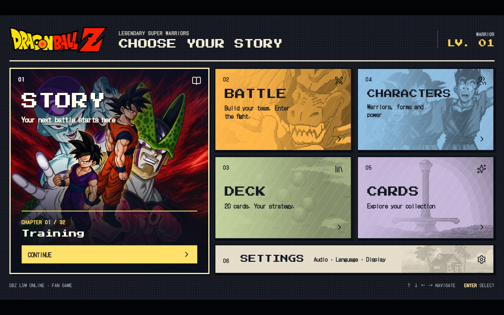
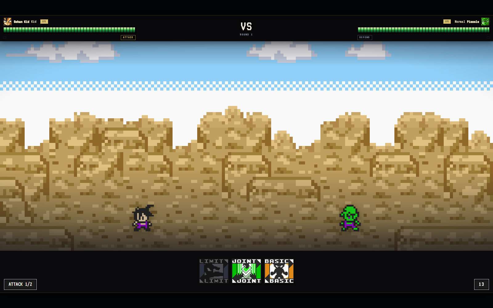
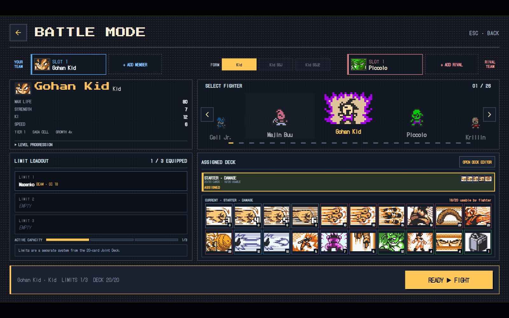
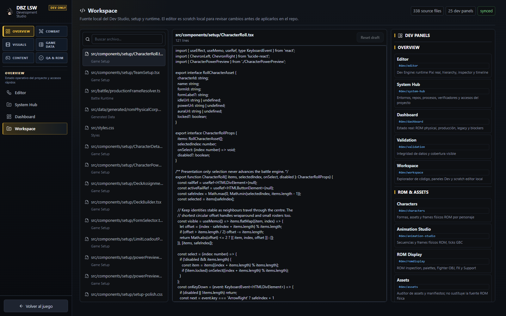

# DBZ LSW Fangame

An unofficial fan project inspired by **Dragon Ball Z: Legendary Super Warriors** for Game Boy Color.

**Card-based combat · 4 tactical positions · Stage Attack QTEs · 26 characters · 48 forms · 125 cards**

  
  

  
  

> This is an unofficial, non-commercial fan project. It is not affiliated with, endorsed by, or sponsored by the original creators or publishers. See [asset and rights notes](ASSET_RIGHTS.md).

## Project status

This repository contains a desktop-first remake runtime and its development/research tools. The application models the original battle system; it is **not an emulator frontend and does not currently boot or execute a Game Boy Color ROM**. No ROM binary is distributed here.

| Area | Status |
| --- | --- |
| Game runtime | React, TypeScript, PixiJS and the project battle engine |
| Desktop shell | Tauri 2; Windows packaging configuration is included |
| Offline base game | Designed to run locally without a backend |
| ROM research tools | Included as development tooling, outside the product bundle |
| Embedded GBC core | Not implemented |
| Generated physical ROM sprite/FX data | Local, ignored build outputs; see the asset pipeline notes |
| Public binary releases | None published yet |

ROM-derived observations are kept distinct from verified behavior, inferences and pending research. The ROM execution model is described in [ROM execution modes](docs/architecture/ROM_EXECUTION_MODES.md).

## What is in the project

- Turn-based card combat with four tactical positions and a CC/Ki economy.
- Stage Attack input sequences and timing windows.
- One-on-one and team battle setup.
- A roster, forms, cards, story content and local player progress.
- A PixiJS presentation layer and an internal Development Studio for inspection.
- Research, data-generation and verification tools that remain separate from the player-facing runtime.

Some visual, audio and research materials are based on the original game. Their rights remain with their respective owners; the source-code license does not grant rights to those materials. See [ASSET_RIGHTS.md](ASSET_RIGHTS.md) and [LICENSE](LICENSE).

## Screenshots

The images above were captured from the current game build and Development Studio workspace. The older August 2026 captures are retained in [the screenshot archive](docs/screenshots/archive/2026-08-31/) for historical comparison and are not used as current product screenshots.

## Getting started

### Requirements

- Node.js 22 or newer, below 25.
- npm 10 or newer.
- Rust and the Tauri platform prerequisites only for the desktop shell.
- ROM research dependencies only when working on the research tools.

### Web development

~~~bash
nvm use
npm ci
npm run dev
~~~

Vite serves the development app at http://localhost:5178/. Useful local checks:

~~~bash
npm run typecheck
npm run build
npm test
npm run verify:ci
~~~

The base UI can be explored without installing the research toolchain. ROM-derived physical sprite and effects outputs are intentionally ignored and are not generated by a normal clone. Without those local outputs, ROM-backed inspection surfaces can be incomplete; the game retains its available fallback presentation. Never commit a ROM, save file, credentials, or locally generated private research data.

### Desktop development

~~~bash
npm run desktop:dev
npm run desktop:build
~~~

See [development environments](docs/development/ENVIRONMENTS.md) and the [desktop offline architecture](docs/architecture/DESKTOP_OFFLINE_ARCHITECTURE.md) for platform setup.

## Development Studio

Start the development server, then open the [Development Studio workspace](http://localhost:5178/#dev/workspace) or [Dev Engine editor](http://localhost:5178/#dev/editor). These routes are development-only and are not part of the production bundle.

## Documentation

- [Documentation index](docs/README.md)
- [Contributing guide](CONTRIBUTING.md)
- [Architecture and execution modes](docs/architecture/ROM_EXECUTION_MODES.md)
- [Development environment](docs/development/ENVIRONMENTS.md)
- [Dev Engine editor](docs/DEV_ENGINE_EDITOR.md)
- [Security policy](SECURITY.md)
- [Asset and rights notes](ASSET_RIGHTS.md)
- [Changelog](CHANGELOG.md)

## Contributing

Contributions are welcome. Fork the repository, create a focused branch from main, and open a pull request. The contribution guide covers setup, verification, asset provenance and review expectations.

## License

Original source code and documentation are available under the MIT License as scoped in [LICENSE](LICENSE). Dragon Ball names, characters, artwork, audio, marks, game content, and other third-party materials are excluded from that grant.
